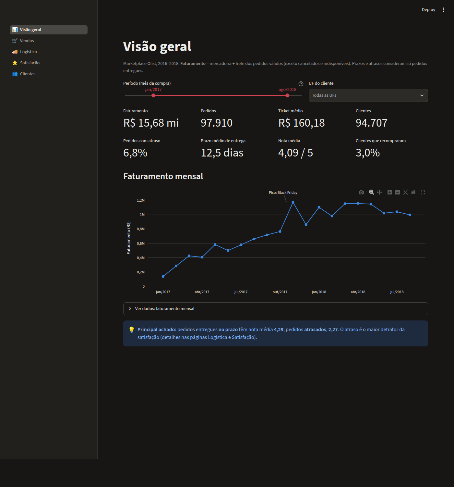
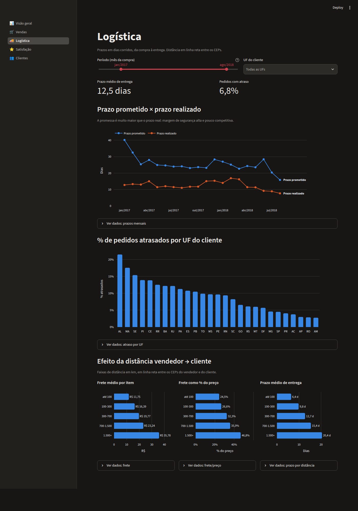

# Brasil E-commerce: pipeline de dados analítico

Pipeline de dados de ponta a ponta sobre o [dataset público de e-commerce brasileiro da Olist](https://www.kaggle.com/datasets/olistbr/brazilian-ecommerce)
(~100 mil pedidos, 2016–2018), construído só com ferramentas **open source**, seguindo práticas
de mercado de *analytics engineering*.

> 🚧 **Em construção.** O roadmap abaixo mostra o andamento.

## Arquitetura (alvo)

```
Kaggle (CSV) ──► Ingestão (Python) ──► DuckDB [raw]
                                          │
                                   dbt ───┼──► staging      limpeza e tipagem
                                          ├──► intermediate regras e agregações
                                          └──► marts        modelo estrela (Kimball)
                                                   │
                                                   ▼
                                       Dashboard (Streamlit) · CSV → Tableau Public

Orquestração: Dagster  ·  Qualidade: testes dbt  ·  CI: GitHub Actions
```

## Stack

| Camada          | Ferramenta                        |
|-----------------|-----------------------------------|
| Linguagem       | Python 3.12, SQL                  |
| Ambiente        | uv (dependências com lockfile)    |
| Armazenamento   | DuckDB                            |
| Transformação   | dbt-core + dbt-duckdb             |
| Orquestração    | Dagster                           |
| Visualização    | Streamlit + Plotly; Tableau Public (via CSV) |
| Qualidade       | ruff, pre-commit, pytest, testes dbt |
| CI              | GitHub Actions                    |

## Como rodar

Pré-requisitos: [uv](https://docs.astral.sh/uv/getting-started/installation/) e `make`.

```bash
git clone <url-do-repositorio>
cd brasil_ecommerce
make setup      # cria .venv, instala dependências e ganchos do pre-commit
make check      # lint + testes
make run        # pipeline completo via Dagster: ingestão → dbt build → publicação
make dagster    # interface do Dagster (lineage, execuções, agendamento) em http://localhost:3000
make dashboard  # dashboard em http://localhost:8501
make docs       # documentação do dbt em http://localhost:8080
```

Para consultar os dados (DBeaver, dashboard), use **`data/consulta.duckdb`**. O arquivo
`data/warehouse.duckdb` é de uso exclusivo do pipeline (veja *Orquestração e publicação*).

O download do Kaggle não exige credenciais (dataset público). O warehouse fica em
`data/warehouse.duckdb`.

Comandos disponíveis: `make help`.

## Decisões técnicas

**Ingestão (camada raw)**

- **Todas as colunas como `VARCHAR`.** A camada raw é fiel à fonte e a tipagem é feita de forma
  explícita no staging (dbt). Isso evita, por exemplo, que prefixos de CEP como `01310` virem o
  número `1310`.
- **Carga atômica.** As 9 tabelas são recriadas em uma única transação: se qualquer arquivo violar
  o contrato (colunas obrigatórias ou arquivo vazio), há rollback e o warehouse permanece intacto.
- **Idempotente.** Rodar a ingestão N vezes produz o mesmo estado. O download só acontece se
  faltar algum arquivo (ou com `--force-download`).
- **Auditoria.** Toda tabela raw tem `_source_file` e `_loaded_at`.

**Transformação (dbt)**

| Camada | Materialização | Papel |
|---|---|---|
| `staging` | view | 1:1 com a fonte: renomeia, tipa e limpa. Sem joins. |
| `intermediate` | view | Regras de negócio e mudança de granularidade (ex.: pagamentos → pedido). |
| `marts` | table | Modelo estrela consumido pelo BI. |

Modelo estrela (`marts`):

- **Fatos:** `fato_pedidos` (1 linha por pedido) e `fato_itens_pedido` (1 linha por item)
- **Dimensões:** `dim_clientes`, `dim_produtos`, `dim_vendedores`, `dim_datas`

**Nomenclatura:** as camadas internas (`raw`, `staging`, `intermediate`) mantêm os nomes em
inglês, próximos da fonte, para facilitar a rastreabilidade. A camada `marts`, que é o contrato
com o BI e o negócio, usa nomes em português por extenso, em snake_case e sem acentos
(ex.: `valor_frete`, `dias_atraso_entrega`, `cliente_recorrente`).

Armadilhas do dataset tratadas na modelagem (identificadas por perfilamento dos dados):

- **Pagamentos múltiplos:** ~3 mil pedidos têm mais de um pagamento. São agregados por pedido
  *antes* do join, para não duplicar a receita.
- **Avaliações:** `review_id` não é único e ~550 pedidos têm mais de uma avaliação. Fica a mais
  recente, com desempate determinístico.
- **Cliente real:** a Olist gera um `customer_id` por pedido. A dimensão usa o
  `customer_unique_id`, sem o qual a taxa de recompra seria sempre 0%.
- **Geolocalização:** vários pontos por CEP, grafias divergentes e pontos fora do Brasil.
  Consolidado pela mediana das coordenadas dentro do território nacional.
- **Atraso de entrega:** comparado no nível de dia, porque a data prometida não tem hora.

**Qualidade de dados**

Cada `make transform` executa 120 testes. Uma falha interrompe o pipeline antes que dados
errados cheguem ao BI.

| Tipo | O que garante | Exemplos |
|---|---|---|
| **Testes genéricos** | Integridade estrutural | Chaves únicas e não nulas; integridade referencial fato → dimensão; domínios fechados |
| **Regras de negócio** | Coerência dos dados | `valor_pedido = valor_itens + valor_frete`; entrega após a compra; nota entre 1 e 5 |
| **Testes com limiar** | Anomalias conhecidas da origem, monitoradas | 166 pedidos com envio antes da compra: alerta acima de 200, erro acima de 1.000 |
| **Testes singulares** | Reconciliação entre camadas | Valor total dos itens idêntico em staging e nas duas fatos; nenhum pedido perdido |
| **Testes unitários** | A *lógica* dos modelos, com dados fictícios | Atraso comparado por dia; forma de pagamento principal; distância SP → RJ = 360,7 km |
| **Contratos** | Nomes e tipos das colunas dos marts | Uma mudança de tipo quebra o build em vez de quebrar o dashboard |

Os testes foram validados com *mutation testing*: três bugs introduzidos de propósito (regra de
atraso, tipo de coluna e join duplicando valores) foram todos detectados.

**Orquestração e publicação (Dagster)**

O pipeline é um grafo de *assets* no Dagster, com lineage de ponta a ponta:

```
arquivos_brutos_olist → olist/* (raw) → staging/* → intermediate/* → marts/* → banco_consulta
```

- **Integração com o dbt:** cada modelo vira um *asset* e cada teste vira um *asset check*
  (99 checks visíveis na interface).
- **Metadados por execução:** linhas carregadas por tabela, tamanho do banco publicado.
- **Agendamento:** execução diária às 6h (horário de Brasília). Vem desligado, porque o dataset
  é estático; ative pela interface.
- **Write-audit-publish:** o DuckDB não permite escrita enquanto outro processo lê o arquivo. Por
  isso o pipeline escreve em `warehouse.duckdb` e, **só se todos os testes passarem**, publica
  uma cópia atômica em `consulta.duckdb`, usada pelo BI e pelo DBeaver. Validado: com um teste
  falhando de propósito, a execução é interrompida e o banco de consulta permanece intacto.

**Visualização**



Dashboard em **Streamlit** com 5 páginas (visão geral, vendas, logística, satisfação e
clientes) e filtros de período e UF compartilhados entre as páginas.

- **Consultas separadas da interface** (`src/brasil_ecommerce/dashboard/queries.py`) e
  testadas com um banco fictício. Os testes também renderizam cada página.
- **Definições de negócio explícitas e únicas:** pedido válido, faturamento, ticket médio
  e atraso.
- **Boas práticas de visualização:** paleta validada para daltonismo (com variação para o modo
  escuro), um eixo por gráfico, rótulos em pt-BR e uma tabela com os dados de cada gráfico.
- **Tableau Public:** o *asset* `exportacao_tableau` gera os marts em CSV. Veja o
  [guia do Tableau](docs/tableau.md).

Principais achados:

| Achado | Número |
|---|---|
| Nota média: entregue no prazo × com atraso | **4,29 × 2,27** |
| Nota com mais de 8 dias de atraso | **1,70** |
| Frete como % do preço: até 100 km × acima de 1.500 km | **24% × 47%** |
| Prazo prometido × realizado (média) | **~24 × ~12 dias** |
| Clientes que compraram mais de uma vez | **3%** |



## Estrutura

```
├── src/brasil_ecommerce/   # pacote Python (configuração, ingestão, publicação, orquestração)
├── transform/              # projeto dbt
├── dashboard/              # aplicação Streamlit
├── docs/                   # guia do Tableau e imagens
├── dagster_home/           # instância local do Dagster (só dagster.yaml é versionado)
├── tests/                  # testes automatizados
├── notebooks/              # análise exploratória
├── data/                   # dados locais, fora do git (raw/ + warehouse.duckdb)
├── pyproject.toml          # dependências e configuração das ferramentas
└── Makefile                # interface de comandos
```

## Roadmap

- [x] **Fase 1: fundação** (git, uv, ruff, pre-commit, configuração centralizada, testes)
- [x] **Fase 2: ingestão** (Kaggle → DuckDB, camada raw com validação)
- [x] **Fase 3: transformação** (dbt: staging → intermediate → marts)
- [x] **Fase 4: qualidade** (testes de dados e regras de negócio)
- [x] **Fase 5: orquestração** (Dagster)
- [x] **Fase 6: visualização** (Streamlit + exportação para Tableau Public)
- [ ] **Fase 7: CI/CD e documentação**

## Licença

MIT
